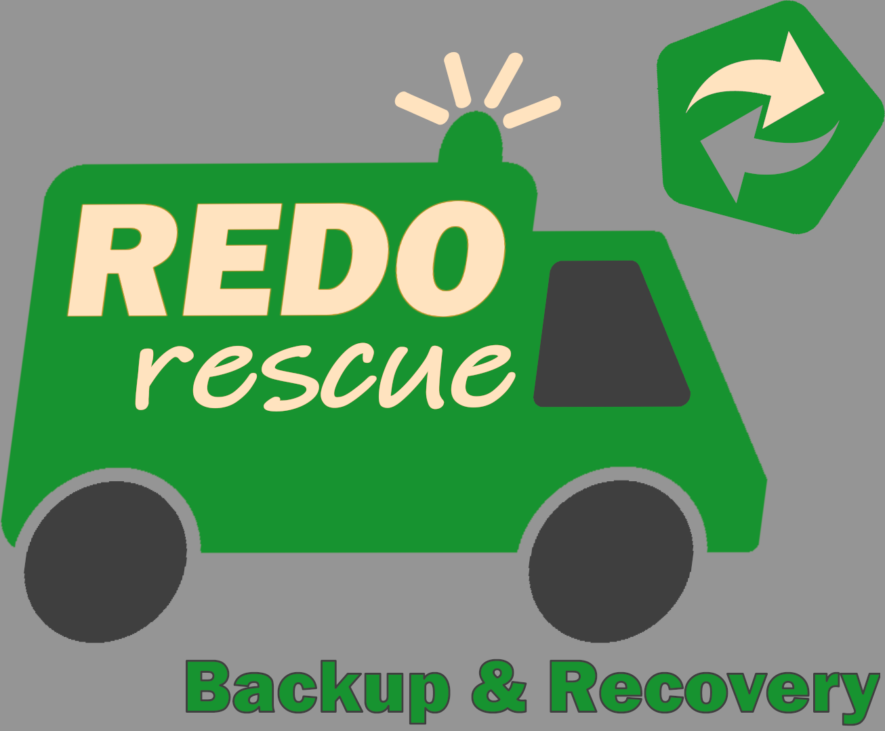
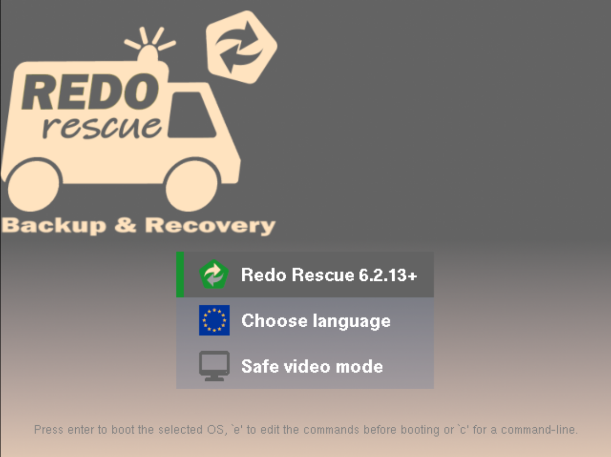
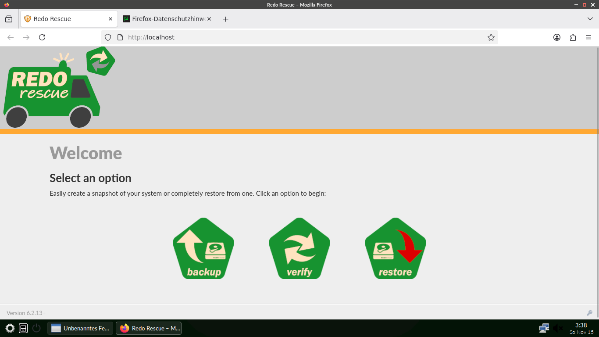
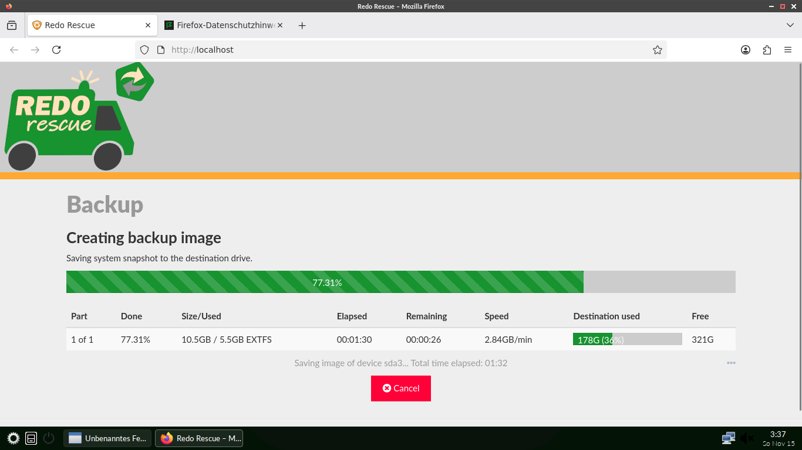
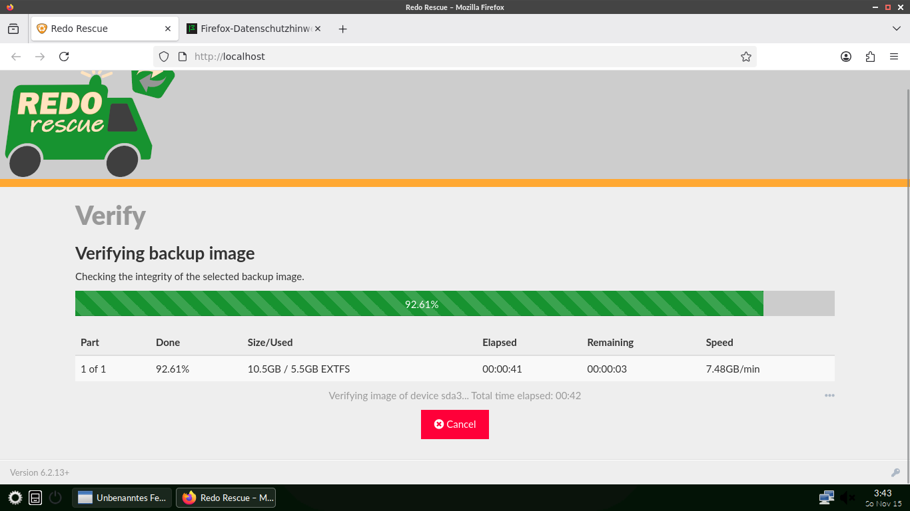
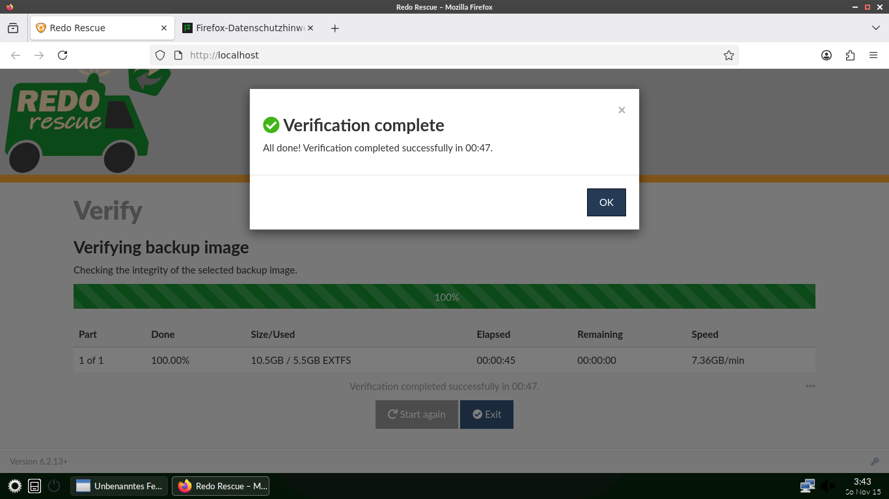
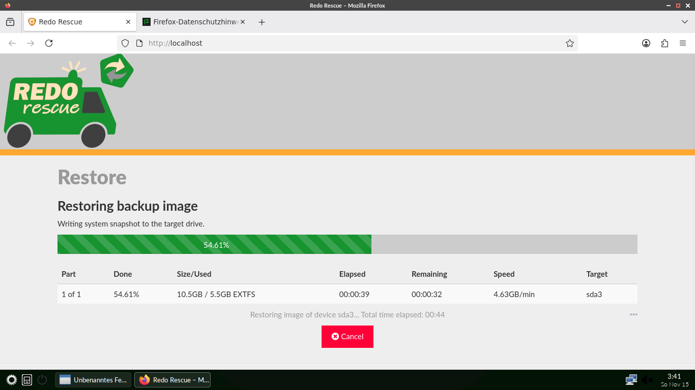

<p align="center">
  
</p>

# Redo Rescue 6.2.13+ (Debian 13 "Trixie" Community Edition)

An updated, modern community fork of **Redo Rescue** based on **Debian 13 (Trixie)**.  
This edition brings full hardware support for modern PCs while keeping reliable compatibility with older Legacy-BIOS machines.

---

## 📥 Download (Ready-to-Use ISO)

You don't need to build the image yourself!  
Download the latest pre-built `.iso` file directly from the **[Releases](../../releases)** page and write it to a USB flash drive using **Rufus**, **BalenaEtcher**, or `dd`.

---

## 🖼️ Screenshots

| Boot Menu (GRUB Multi-Language) | Refreshed simple Web-UI |
| :---: | :---: |
|  |  |
|  |  |
|  |  |

---

## 📋 Overview & Key Features

* **Redo Rescue** let you boot into a Debian live system and take backups from your hard drive(s) or partitions of them or recover them - even on a new drive. Built-in **Application** for optimized support:
gParted, gEdit, Timeshift, midnight-commander, gnome-Screenshot, terminal, system-info.
* **Modern Debian 13 (Trixie) Base:** Built on Debian 13 with an up-to-date Linux kernel, current `non-free-firmware` packages (modern NVMe controllers, Wi-Fi, and Ethernet chipsets), and **PHP 8.4**.
* **True Hybrid Boot (UEFI & Legacy BIOS):** Boots seamlessly on modern 64-bit UEFI hardware as well as older Legacy-BIOS systems—including full compatibility with standard **Rufus ISO mode** (`i386-pc` GRUB modules included) and a **Safe Video Mode** fallback.
* **Verified Boot Compatibility:** Successfully tested with **Rufus (both MBR and GPT partition schemes)**, **VMware**, modern UEFI systems, and legacy BIOS hardware.
* **European Multi-Language Boot Menu (8 Languages):** Choose your language directly in the GRUB boot menu (**Deutsch, English, Español, Français, Italiano, Nederlands, Polski, Ukrainian**). Desktop menus, system clock/date formatting, keyboard layout, and Firefox ESR adapt automatically. Modify grub-configuration to add more or your special language. 
* Replaced Chromium with **Firefox ESR** (including language packs), allowing one-click translation of the Redo Rescue web interface into your selected languager.
* **Refreshed simple Web-UI**.
* **Add or modify** the Debian-, software- und system-environment for your needs (see build-instructions).

---

## ⚠️ Known Limitations (Apple / Mac Hardware)

* **Legacy Apple Mac / HFS+ Support Removed:** Support for older Intel Macs via Apple Partition Map (`-isohybrid-apm-hfsplus`) and `hfsprogs` has been removed because `hfsprogs` is no longer included in Debian 13 (Trixie).
* Modern 64-bit UEFI Macs (approx. 2012 and newer) may still boot via the standard `EFI/BOOT/BOOTX64.EFI` bootloader, but Apple-specific HFS+ tools and legacy Mac boot hooks are not included.
* **Older Hardware & USB 2.0 Speeds:** When booting from or backing up to a **USB 2.0** drive on older machines, initial system startup and block scanning (*"Finding areas with data..."*) may take a few minutes. Please be patient—this is normal behavior due to USB 2.0 bandwidth limits and not a system freeze or error.


---

## 🇩🇪 Kurzübersicht (Deutsch)

Eine aktualisierte Community-Edition von **Redo Rescue** auf Basis von **Debian 13 (Trixie)** für moderne wie auch ältere PC-Hardware:

* **Redo Rescue** startet PCs in ein Debian Live System und erstellt Backups (oder stellt diese wieder her) von ganzen Laufwerken oder einzelnen Patitionen.
* Mit dabei sind **gParted**, **gEdit**, **Gnome-Screenshot(ohne s)**, **midnight-Commander**, **Timeshift** - für reibungslosen Support. 
* **Fertige ISO herunterladen:** Die fertige `.iso`-Datei findest du direkt rechts unter **[Releases](../../releases)** – einfach mit **Rufus** (getestet), **BalenaEtcher** oder `dd` auf einen USB-Stick schreiben (MBR- und UEFI-/GPT-Partitionschema unterstützt).
* **Aktueller Unterbau:** Debian 13 (*Trixie*) mit modernem Kernel, aktuellen Firmware-Paketen (`non-free-firmware`) und **PHP 8.4**.
* **UEFI & Legacy-BIOS / Rufus-kompatibel:** Bootet zuverlässig im UEFI- und Legacy-BIOS-Modus (erfolgreich bis zur **Erschöpfung** getestet mit **Rufus MBR & GPT**, **VMware** sowie echter UEFI- und Legacy-Hardware) sowie über den **Safe Video Mode**.
* **Mehrsprachiges anpassbares Bootmenü (8 Sprachen):** Direkte Sprachauswahl im GRUB-Startmenü (*Deutsch, English, Español, Français, Italiano, Nederlands, Polski, Ukrainian*) mit automatischer Umstellung von Desktop, Tastaturlayout, Datumsformat und Firefox ESR.
* **Direkte Übersetzung der Weboberfläche via ** **Firefox ESR** (ersetzt Chromium). 
* **Hinweis zu Apple / Mac:** Die alte Mac-Boot-Unterstützung (`-isohybrid-apm-hfsplus`) sowie `hfsprogs` wurden entfernt, da `hfsprogs` in Debian 13 (*Trixie*) nicht mehr enthalten ist.
* **Ältere Hardware & USB 2.0:** Beim Booten oder Sichern über eine **USB-2.0-Schnittstelle** auf älteren Rechnern können der Systemstart sowie die anfängliche Blocksuche (*„Finding areas with data...“*) etwas Zeit in Anspruch nehmen. Etwas Geduld steigert die Lebensqualität.


---
## 🚀 Building from Source

Run the build script on any Debian-based host system (all required build dependencies are installed automatically by the script):

```bash
git clone https://github.com/Turboschnuffi/redorescue.git
cd redorescue
sudo ./make
```

### Customizing the System (`chroot` Mode)

If you want to install additional packages or modify the root filesystem before building the ISO, you can enter the interactive `chroot` environment:

```bash
sudo ./make changes
# Make your modifications inside the chroot environment, then leave it with:
exit
```

---

## 📜 License & Credits

* **Original Project:** Based on [Redo Rescue](https://github.com/redorescue/redorescue.git) by **Zebradots / Redo Rescue Contributors**.
* **License:** Code and build scripts are distributed under the **GNU General Public License v3.0 (GPLv3)** — see the `LICENSE` file for full details. Custom mascot artwork and button graphics included in the web interface remain the property of the release author.
---

---

## ☕ Support / Käffchen? 

If this community fork helped rescue your system or saved you some time, feel free to support future updates and hardware testing with a small tip!  
Wenn Dir Redo Rescue geholfen, Zeit oder womöglich Schlimmeres erspart hat – ich freue mich immer über ein virtuelles Trinkgeld.

* **[Buy me a coffee on Ko-fi](https://ko-fi.com/turboschnuffi)**
